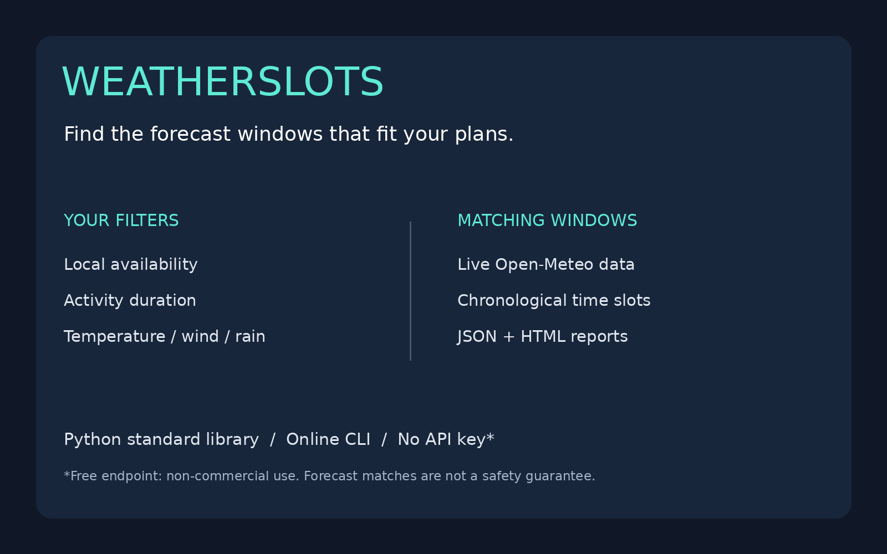
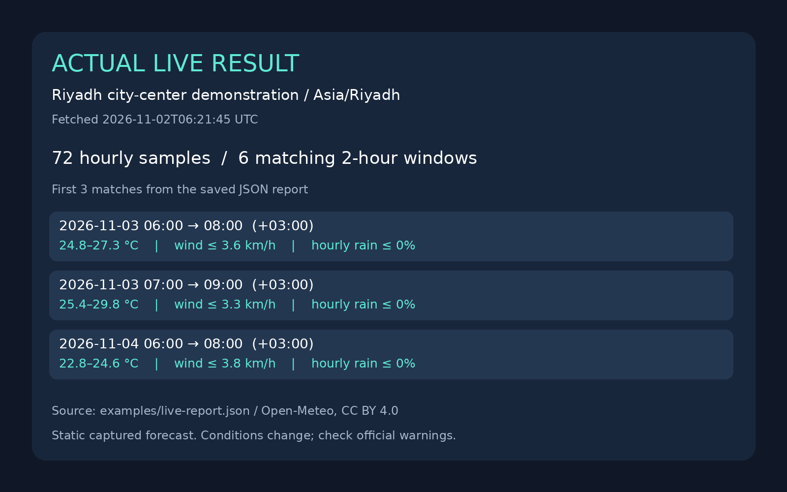

# WeatherSlots

    



**Turn an hourly weather forecast into time windows that match your own filters.**

Planning a walk, a photography session, a garden task or an outdoor meetup often means checking several weather charts and comparing them with your available hours. WeatherSlots does that comparison: give it coordinates, local availability, duration and weather thresholds; receive matching intervals as terminal output, JSON or a self-contained HTML report.

This is an online command-line tool. It fetches a forecast on every run; it does not host a website or monitor in the background.

## Features

- Live Open-Meteo forecast, with explicit Celsius and km/h units.
- Temperature range, maximum wind and maximum hourly rain probability filters.
- One to twelve elapsed hours per candidate; local daily availability and IANA timezones.
- UTC interval arithmetic handles daylight-saving transitions; labels include UTC offsets.
- Missing samples and gaps exclude affected candidates instead of being treated as good weather.
- Readable terminal output, structured JSON and escaped HTML with source attribution.
- Bounded response size, request timeout, no redirects, no hidden retries and atomic HTML replacement.
- No API key, account, or third-party Python runtime packages for the free non-commercial endpoint.

## Installation

Requires Python 3.10+ and an installed IANA timezone database (normally included on Linux/macOS). On systems without timezone data, install your OS timezone package or the small optional `tzdata` Python package.

```bash
git clone https://github.com/dxrkf/weatherslots.git
cd weatherslots
python weatherslots.py --help
```

## Usage

Public city-center coordinates below are demonstration data, not a user's location.

```bash
python weatherslots.py \
  --latitude 24.7136 --longitude 46.6753 --timezone Asia/Riyadh \
  --duration 2 --from-hour 6 --to-hour 22 \
  --min-temp 10 --max-temp 30 --max-wind 20 --max-rain 20
```

Actual captured live run, fetched **2026-11-02 06:21 UTC**:

```text
WeatherSlots: 72 hourly samples, 6 matching windows
2026-11-03T06:00:00+03:00 -> 2026-11-03T08:00:00+03:00 | 24.8..27.3 C | wind <= 3.6 km/h | rain <= 0%
2026-11-03T07:00:00+03:00 -> 2026-11-03T09:00:00+03:00 | 25.4..29.8 C | wind <= 3.3 km/h | rain <= 0%
...
```

Your run will differ as forecasts and the current time change. The complete captured result is [live-report.json](examples/live-report.json), with a matching [HTML dashboard](examples/live-dashboard.html). Download the HTML and open it in a browser; GitHub may display its source.



Export both formats in one API request:

```bash
python weatherslots.py --latitude 24.7136 --longitude 46.6753 \
  --timezone Asia/Riyadh --json --html report.html > report.json
```

A JSON window looks like:

```json
{
  "start": "2026-11-03T06:00:00+03:00",
  "end": "2026-11-03T08:00:00+03:00",
  "duration_hours": 2,
  "min_temp_c": 24.8,
  "max_temp_c": 27.3,
  "max_wind_kmh": 3.6,
  "max_hourly_rain_probability": 0
}
```

`--days` accepts 1–7 (default 3); `--timeout` accepts 1–60 seconds (default 30). Availability is a same-day interval: `0` to `24` covers the whole day; overnight ranges such as `22` to `6` are not supported. Thresholds are inclusive. All overlapping matching windows are returned chronologically, without ranking or merging.

Exit code `0` means a successful forecast check, including zero matches; `2` means invalid arguments, unavailable timezone data, network failure or invalid data. On failure an existing HTML report is left untouched and may be stale; check the exit code and fetched timestamp. Shell redirection can truncate an existing JSON file even when the command fails. Use a temporary file and move it after success if preserving prior JSON matters.

## What the matching logic means

A two-hour window requires three consecutive hourly boundaries. Temperature and wind must meet your filters at every boundary. Open-Meteo's hourly precipitation probability describes the **preceding hour**, so the tool tests the endpoint rain samples for the hours inside each window. It reports the maximum hourly probability, not a combined probability over the whole activity.

Only future start boundaries are considered; the tool does not interpolate between samples. Duration is elapsed time, so a local clock can repeat or skip hours across daylight-saving changes. A forecast period may contain fewer usable future hours than `--days × 24`, because the API's daily range includes hours earlier today.

## Network, privacy and cost

Each successful invocation makes one HTTPS request to `api.open-meteo.com`. The provider receives the coordinates and your network address. Choose a public city center when coarse location is sufficient. There is no automatic location detection, telemetry, or credential storage.

The free endpoint is intended for **non-commercial use**, subject to provider rate limits. No paid resource is created. Commercial or high-volume use requires reviewing [Open-Meteo pricing and terms](https://open-meteo.com/en/pricing) and adapting the client for the appropriate endpoint. HTTP failures, including rate limits, stop the run; there is no retry loop. If automating, keep request frequency low and handle nonzero exit status.

Weather data: [Open-Meteo](https://open-meteo.com/), [CC BY 4.0](https://creativecommons.org/licenses/by/4.0/). API field definitions: [official forecast documentation](https://open-meteo.com/en/docs). Attribution is retained in JSON, HTML and terminal output. The code's MIT license does not replace the data license.

## Limits

- Forecast matches are **not a safety guarantee** or an official weather warning. Check local warnings separately.
- Hourly model samples can miss short-lived rain, gusts and conditions between boundaries. Forecasts can change.
- No UV, air quality, humidity, solar daylight, terrain, road conditions or personal health assessment. Availability hours do not imply daylight.
- A location/timezone mismatch is possible; choose the correct IANA timezone yourself. No geocoding is performed.
- Snapshots are static. Rerun to refresh; nothing is sent as a push notification by this CLI.
- Network access is required. There is no cached fallback or service uptime guarantee.

## Tests

```bash
python -m unittest -v
```

22 deterministic tests cover boundary inclusivity, precipitation alignment, missing values, gaps, past times, local availability, fractional offsets, midnight, DST elapsed duration, malformed input/units, HTTP 429, network failures, response-size limits, HTML escaping and atomic/symlink output handling. They do not call a live API. A separate real API run produced the checked-in demonstration artifacts; it is evidence of one successful request, not provider availability over time.

## Suggested GitHub topics

`weather` `forecast` `open-meteo` `python` `cli` `planning` `dashboard` `productivity`

Code: MIT. Demo forecast attribution: Open-Meteo, CC BY 4.0.
